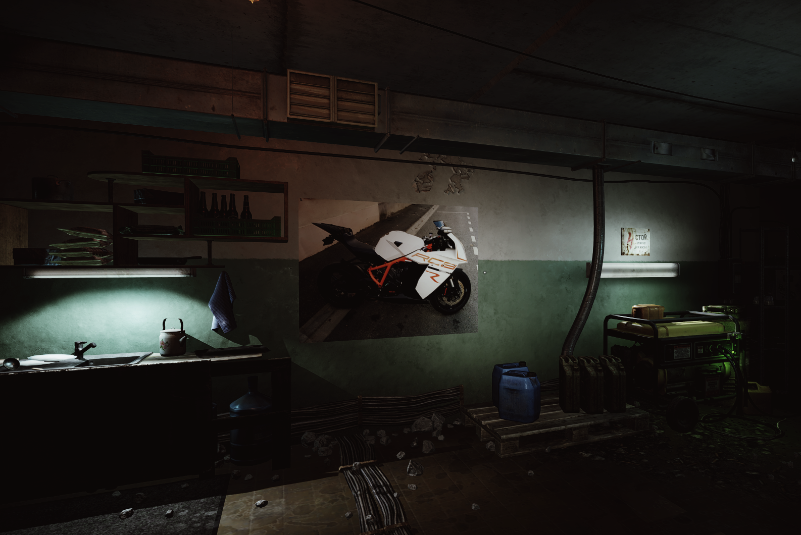

# Hideout Posters — Early Access

**Put your own pictures on your hideout walls.** Every image you drop in a folder becomes a real poster item: sold by Ragman, shown in your inventory with its own icon, and hung on the hideout walls with the game's customization menu.

> 🚧 **Early Access** — the mod works today and is actively developed. Big features are on the way (see Roadmap): this is going to be a **huge mod in terms of fun**. The mod is currently in **English** (F12 menu). **16 languages are coming in a future update.**


## 📸 Screenshots


*An included poster on the hideout walls*


*Your own photo as a poster — landscape format, real proportions*

## ✨ Features

- 🖼️ **Any image becomes a poster**: one `.png` / `.jpg` file = one poster
- 🏷️ **Named after the file**: `my_cool_poster.png` → *My cool poster*
- 🛒 **Sold by Ragman**: 1,000 ₽, loyalty level 1, unlimited stock
- 🎒 **Custom inventory icon**: the icon shows your picture
- 📐 **Real proportions**: portrait, landscape or square, the poster takes the shape of your image
- 📌 **Free placement**: hang any poster **anywhere** in the hideout, not only on the game's poster spots
- 📏 **Size settings in F12**: one size for all posters + one slider per poster (×0.25 to ×3, changes live)
- 🧾 **4 original posters included** as a starter pack
- 🐞 **Bug report** button in F12

## 📦 Installation

1. **Close the game and the SPT server.**
2. Open the zip and **extract everything into your SPT folder** (the folder that contains `BepInEx` and `SPT_Runtime`). Accept to merge folders.
3. **Start the SPT server**, then the game.

You should now have:
```
SPT/
├─ BepInEx/plugins/HideoutPosters.Client.dll        ← client part (images, icons, sizes)
├─ BepInEx/config/HideoutPosters/                   ← your poster images go here
│   ├─ Hideout rules.png
│   ├─ Keep the generator running.png
│   ├─ Lost dog.png
│   └─ Steel Winter.png
└─ SPT_Runtime/user/mods/HideoutPosters/            ← server part (creates and sells posters)
```

**No dependencies.** Both parts (server + client) are required.

## 🎮 How to use

1. Go to **Ragman** → you'll find one poster per image (1,000 ₽ each).
2. Buy the posters you want.
3. In your hideout, open the **customization menu** and choose a poster spot (for example in the rest space or the gym).
4. Pick your poster in the list: it appears on the wall with your picture.

## 🖼️ Adding your own posters

1. Copy your images into `BepInEx/config/HideoutPosters/` (`.png`, `.jpg` or `.jpeg`).
2. **Restart the SPT server** — it creates one poster per image at startup. Without a restart, new images don't appear at Ragman.
3. Buy them from Ragman and hang them.

Tips:
- **The file name becomes the poster name.** `_` and `-` become spaces.
- **PNG recommended.** Use **1000 px or more** on the long side for a sharp result, especially on big posters. Small images (300 px) look blurry up close.
- Any shape works: portrait, landscape, square.

## 📌 Free placement (anywhere!)

Hang your images anywhere in the hideout — pillars, corridors, ceilings — no item needed:
- **P**: start placement mode — the poster follows your aim, flat on the wall
- **← / →**: change image (name shown at the bottom of the screen)
- **Enter**: hang it
- **P** again: cancel
- **Delete**: take down the free poster you are looking at

Free posters are saved and come back every time you enter the hideout. Their size follows the F12 settings. All keys can be changed in **F12 → Free placement**.

## 📏 Size settings (F12)

Open **F12 → Hideout Posters**:
- **Size**: changes the size of **all** posters at once.
- **Size per poster**: one slider per image. Two posters using the same image share the same slider.
- Final size = *Size* × *Size per poster*. Changes are applied **live**, no restart needed.
- A slider appears for **every image in the folder**, even if the poster isn't hung yet: you can set its size in advance.

## 🗑️ Don't like the included posters?

The 4 included posters are just a starter pack. To remove one (or all of them):
1. If it's hanging in your hideout, **take it down first**.
2. Delete its file from `BepInEx/config/HideoutPosters/` (e.g. `Lost dog.png`).
3. **Restart the SPT server**: Ragman stops selling it.

Your own images work exactly the same way: add a file to get a poster, delete it to remove it from the shop.

## ⚠️ Before uninstalling

Posters are real items. **Take down and sell all your posters before removing the mod**, otherwise your profile may fail to load.
Removing an *image* (not the mod) is safe: the mod remembers every poster it has created.

## ❓ FAQ

**My new image doesn't appear at Ragman.** Restart the SPT server after adding images.

**My poster shows the old "Arena" picture.** The image file was removed or renamed. Put it back, or take the poster down.

**My poster looks wrong (white, stretched…).** Click **Bug report** in F12 while looking at it, close the game and send `BepInEx/LogOutput.log` (see below).

**Can I use any picture?** In your own game, yes. If you share screenshots or packs, use pictures you own or public-domain ones.

## 🗺️ Roadmap

This is only the beginning: Hideout Posters is going to be a **huge mod in terms of fun**. Here's what's coming:


- 🌍 **16 languages** (same as my other mods)
- 🔄 **Rotating shop**: Ragman sells a changing selection
- 📜 **Poster tube**: open it to get a random poster
- 🖼️ **Frames** and **public-domain masterpieces**
- 🎲 **Rare posters** and new ways to find them…

## 💬 Bugs & feedback

Click **Bug report** in F12, then send `BepInEx/LogOutput.log` through a GitHub issue or in private on Discord: **PraED_tv**.

## 📝 Credits

- Mod by **PraED_TV**
- Included posters (*Keep the generator running*, *Lost dog*, *Steel Winter*, *Hideout rules*): original creations made for this mod, MIT license like the code.

---

# 🇫🇷 Français

**Mets tes propres images sur les murs de ta planque.** Chaque image déposée dans un dossier devient un vrai poster : vendu par Ragman, visible dans l'inventaire avec sa propre icône, et accroché aux murs via le menu de personnalisation de la planque.

> 🚧 **Early Access** : le mod fonctionne et est en développement actif, et ce n'est que le début : ça va être un **mod énorme en termes de fun** (boutique tournante, tube à affiches, cadres, tableaux de maîtres, posters rares…). Il est pour l'instant en **anglais** (menu F12). **Les 16 langues arriveront dans une prochaine mise à jour.**

**Installation**
1. Ferme le jeu **et** le serveur SPT.
2. Extrais tout le zip dans ton dossier SPT (celui qui contient `BepInEx` et `SPT_Runtime`).
3. Lance le serveur, puis le jeu.
Aucune dépendance. Les deux parties (serveur + client) sont nécessaires.

**Utilisation** : va chez **Ragman** (un poster par image, 1 000 ₽), achète, puis dans la planque ouvre le **menu de personnalisation**, choisis un emplacement de poster et sélectionne ton poster.

**Ajouter tes images**
1. Mets-les dans `BepInEx/config/HideoutPosters/` (`.png`, `.jpg`).
2. **Relance le serveur** (sinon elles n'apparaissent pas chez Ragman).
3. Achète-les et accroche-les.
Le nom du fichier devient le nom du poster. PNG conseillé, **1000 px ou plus** pour une image nette.

**📌 Pose libre** : colle tes images **n'importe où** dans la planque. **P** = mode pose, **← / →** = changer d'image, **Entrée** = coller, **P** = annuler, **Suppr** = décrocher le poster visé. Sauvegardé automatiquement, touches modifiables dans F12.

**Taille (F12 → Hideout Posters)** : *Size* change tous les posters, *Size per poster* a un curseur par image. Taille finale = les deux multipliés. En direct, sans relancer.

**🗑️ Les affiches incluses ne te plaisent pas ?** Décroche-les si elles sont accrochées, supprime leurs fichiers dans `BepInEx/config/HideoutPosters/` (ex. `Lost dog.png`), puis **relance le serveur** : Ragman ne les vend plus. Pareil pour tes propres images.

**⚠️ Avant de désinstaller** : décroche et vends tous tes posters, sinon ton profil risque de ne plus se charger. Supprimer une *image* (pas le mod) ne pose aucun problème.

**FAQ**
- *Ma nouvelle image n'apparaît pas chez Ragman* → relance le serveur.
- *Mon poster affiche l'ancienne image « Arena »* → le fichier a été supprimé ou renommé : remets-le, ou décroche le poster.
- *Mon poster est bizarre (blanc, déformé…)* → clique **Bug report** dans F12 en le regardant, ferme le jeu et envoie `BepInEx/LogOutput.log`.

**Bugs** : GitHub (issues) ou en privé sur Discord : **PraED_tv**.
