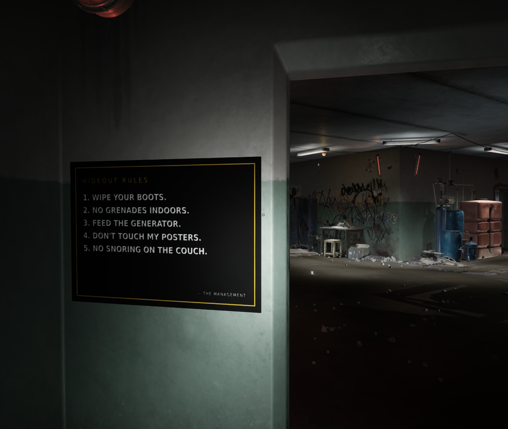

# 🖼️ Hideout Posters

🚧 **EARLY ACCESS** — works today, actively developed.

This is only the beginning: Hideout Posters is going to be a **HUGE mod in terms of fun**.

🌍 Currently in English — **16 languages are coming in a future update.**

---

## 🖼️ HIDEOUT POSTERS — your own pictures on your hideout walls

Drop any image in a folder and it becomes a real poster (i know it's magic :P): sold by Ragman, shown in your inventory with its own icon, and hung on the hideout walls with the game's customization menu.

---

## 📸 SCREENSHOTS

---

## ✨ FEATURES

- One image = one poster (.png / .jpg), named after the file

- Sold by Ragman — 1,000 ₽, loyalty level 1, unlimited stock

- Custom inventory icon showing your picture

- Real proportions: portrait, landscape or square

- 📌 **FREE PLACEMENT**: hang any poster anywhere in the hideout (P = place mode, ←/→ = change image, Enter = hang, Delete = take down, saved automatically)

- F12 size settings: global size + one slider per poster (×0.25 to ×3, live)

- 4 original posters included as a starter pack

- "Bug report" button in F12

---

## 📦 INSTALLATION

1. Close the game **AND** the SPT server

2. Extract the whole zip into your SPT folder (the one containing BepInEx and SPT_Runtime)

3. Start the server, then the game

**No dependencies.** Both parts are required:

- `SPT_Runtime/user/mods/HideoutPosters/` (server: creates and sells the posters)

- `BepInEx/plugins/HideoutPosters.Client.dll` (client: images, icons, sizes)

- Your images go in `BepInEx/config/HideoutPosters/`

---

## 🎮 HOW TO USE

1. Go to Ragman: one poster per image

2. Buy the ones you want

3. In your hideout, open the customization menu, pick a poster spot

4. Select your poster: it appears on the wall with your picture

---

## 🖼️ ADD YOUR OWN POSTERS

1. Put your images in `BepInEx/config/HideoutPosters/`

2. **RESTART THE SPT SERVER** (it creates one poster per image at startup)

3. Buy them from Ragman and hang them

**Tips:** the file name becomes the poster name ("_" and "-" become spaces). PNG recommended, 1000 px or more on the long side for a sharp result.

---

## 📏 SIZE (F12 → Hideout Posters)

- **Size**: all posters at once

- **Size per poster**: one slider per image (set in advance, even before hanging it)

- Final size = Size × Size per poster, applied live

---

## 🗑️ DON'T LIKE THE INCLUDED POSTERS?

1. Take it down if it's hanging in your hideout

2. Delete its file from `BepInEx/config/HideoutPosters/` (e.g. "Lost dog.png")

3. Restart the SPT server: Ragman stops selling it

Your own images work the same way: add a file = new poster, delete it = gone from the shop.

---

## ⚠️ BEFORE UNINSTALLING

Take down and sell all your posters before removing the mod, otherwise your profile may fail to load.

Removing an image (not the mod) is safe.

---

## ❓ FAQ

- **New image not at Ragman?** → restart the SPT server

- **Poster shows the old "Arena" picture?** → its image file was removed or renamed

- **Poster looks wrong?** → click "Bug report" in F12 while looking at it, then send `BepInEx/LogOutput.log`

---

## 🗺️ ROADMAP — the fun is just starting

- 🌍 16 languages + UI

- 🔄 Rotating shop at Ragman

- 📜 Poster tube: open it for a random poster

- 🖼️ Frames and public-domain masterpieces

- 🎲 Rare posters and new ways to find them…

**And a HUGE SECRET……. !**

---

## 💬 BUGS & FEEDBACK

GitHub issues, or in private on Discord: **PraED_tv**

---

## 📝 QUICK SUMMARY

🚧 Early Access: the mod already works and this is only the beginning, it's going to be a HUGE mod in terms of fun. The menu is in English for now, the 16 languages will arrive in a future update.

Every image dropped in `BepInEx/config/HideoutPosters/` becomes a real poster: sold by Ragman (1,000 ₽), with its own icon in the inventory, to hang with the hideout customization menu.

- **Installation**: close the game and the server, extract the whole zip into your SPT folder, restart. No dependencies.

- **Add your images**: put them in the folder, RESTART THE SERVER, buy them from Ragman, hang them. File name = poster name. PNG recommended, 1000 px or more.

- **Free placement**: P = place mode, ←/→ = image, Enter = hang, Delete = take down

- **Size (F12)**: "Size" for all posters, "Size per poster" for each one, live.

- **Don't like the 4 included posters?** Take them down, delete their files, restart the server.

- ⚠️ Take down and sell your posters before uninstalling the mod.

- **Bugs**: "Bug report" button in F12 + LogOutput.log, in private on Discord: PraED_tv

---

## 📝 CHANGELOG

**0.4.1 — Early Access**

- First public release: FREE PLACEMENT anywhere in the hideout, custom posters from your own images, Ragman shop, custom inventory icons, real proportions, global and per-poster size, 4 original posters, bug report button
