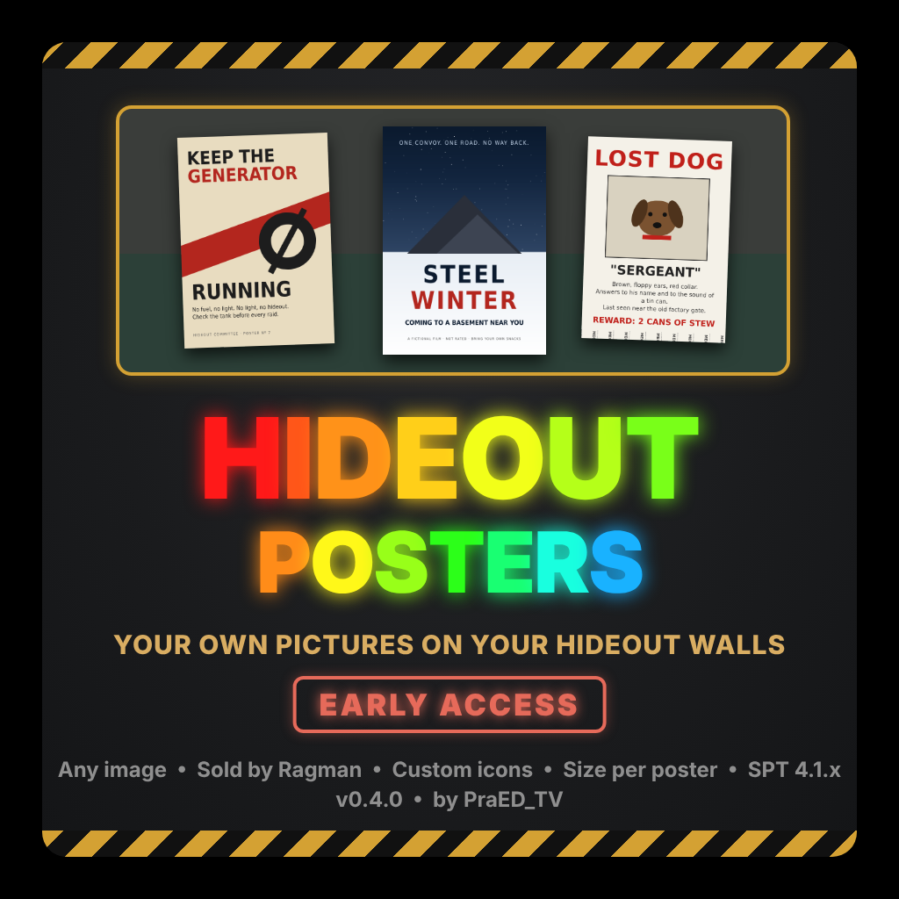

# Hideout Posters — Early Access · v0.5.21

**Put your own pictures on your hideout walls, and turn your shooting range into a real game mode.** Every image you drop in a folder becomes a real poster item, and the new **Range Day** mode brings daily challenges, ranks and real rewards to the hideout shooting range.

> 🚧 **Early Access**: the mod works today, but it is **far from finished**. It is actively developed and **huge updates are on the way.**



## ✨ Posters

- 🖼️ **Any image becomes a poster**: one `.png` / `.jpg` file = one poster, named after the file
- 🎞️ **Animated GIF posters**
- 🏷️ **Stickers**: transparent PNGs are cut out along their shape
- 🛒 **Sold by Ragman** (1,000 ₽), with a custom inventory icon showing your picture
- 📐 **Real proportions**: portrait, landscape or square
- 📌 **Free placement**: hang posters **anywhere** in the hideout (walls, pillars, ceilings), rotate and straighten them
- 💡 **15 light styles**: backlit, lamp, neon, broken neon, string lights, light frame, rainbow, UV blacklight, police neon, fire glow…
- 📎 **Fixings and curled corners** for a real paper look
- 🔫 **Bullet holes**: shoot your posters, holes stay where you hit; a poster can **fall** after too much damage
- 🗺️ **Posters in raids**: find posters on walls during raids
- 🔒 **Collection mode** (optional): your posters start locked; find them in raids and tear them down to unlock them
- 🧾 **4 original posters included** as a starter pack

## 🎯 Shooting range

- 📺 **Range TVs zoom on your shots** (spotter scope), in color, with an **ammo card** of your last bullet
- 🌙 **Night mode**: turn off the range lamps and practice with your flashlight, laser or NVG

## 🎯 Range Day

**Range Day turns your hideout shooting range into a full game mode.** Open it with the **RANGE DAY** action on the АРСЕНАЛ box at the shooting table.


- 🎯 **6 permanent challenges**: Grouping, Bullseye, Speed run, Economy, One shot, Designation
- 📅 **Daily challenges** generated every day (weapon, fire mode, stance, hip fire, night mode, distance…), plus a **weekly challenge** and surprise **flash challenges**
- 🏅 Bronze / silver / gold medals, **records per weapon**, precision shown in cm at 100 m
- 🎖️ **100 ranks**: from Scav up to BEAR or USEC military ranks, with a reward at every rank
- 🔫 **ARSENAL**: mastery level per weapon, with your own weapon build
- 🃏 **Mystery cards**: pick 1 of 3 face-down cards (40 card backs), then see what you missed
- 🎁 **Real game items as rewards**, sent to your messages: good score, good reward; bad score, absurd reward (with a little taunt)
- 🏆 **12 secret achievements**, daily streak bonus, game UI sounds
- 🌍 **16 languages** (follows your system language, or choose it in F12)

**Reset Range Day:** close the game and delete `BepInEx/config/HideoutPosters_rangeday.txt`.

## 📦 Installation

1. **Close the game and the SPT server.**
2. Extract the zip into your **SPT folder** (the one that contains `BepInEx` and `SPT_Runtime`). Accept to merge folders.
3. **Start the SPT server**, then the game.

```
SPT/
├─ BepInEx/plugins/HideoutPosters.Client.dll     ← client part
├─ BepInEx/config/HideoutPosters/                ← your poster images go here
└─ SPT_Runtime/user/mods/HideoutPosters/         ← server part (posters, Range Day rewards)
```

**No dependencies.** Both parts (server + client) are required.

## 🎮 How to use

- **Posters as items**: buy them from **Ragman**, then hang them with the hideout **customization menu**.
- **Free placement**: press **P** to start, **← / →** to change image, **Enter** to hang, **Delete** to take down. All keys (rotate, straighten, edit, lights, fixings, help…) are in **F12 → Free placement**.
- **Your own images**: copy them into `BepInEx/config/HideoutPosters/` and **restart the SPT server**. PNG of 1000 px or more recommended.
- **Range Day**: go to the shooting table and use the **RANGE DAY** action on the АРСЕНАЛ box.

## ⚙️ Settings (F12)

- **Poster**: size (global and per poster), bullet hole size, max image size, range TVs (color, sharpness, zoom, ammo card), night mode, **Bug report**
- **Look**: light power, blinking speed, fixings, curled corner
- **Free placement**: all keys, poster falls after damage
- **In raid**: posters in raids, posters per raid
- **Collection**: collection mode, take poster key
- **Range Day**: rewards on/off, reward multiplier, language

## ⚠️ Before uninstalling

Posters are real items. **Take down and sell all your posters before removing the mod**, otherwise your profile may fail to load. Removing an *image* (not the mod) is safe.

## 🗺️ Roadmap

- Range Day: new challenges and constraints, the duck, Prestige, hand-picked reward lists
- Rotating shop, poster tubes, frames, rare posters…

## 💬 Bugs & feedback

Click **Bug report** in F12, then send `BepInEx/LogOutput.log` through a GitHub issue or in private on Discord: **PraED_tv**.

## 📝 Credits

- Mod by **PraED_TV**
- Included posters and card backs: original creations made for this mod, MIT license like the code.

---

# 🇫🇷 Français

**Mets tes propres images sur les murs de ta planque, et transforme ton stand de tir en vrai mode de jeu.** Chaque image déposée dans un dossier devient un vrai poster, et le nouveau mode **Range Day** apporte défis du jour, rangs et vraies récompenses au stand de tir.

> 🚧 **Early Access** : le mod fonctionne, mais il est **loin d'être fini**. Il est en développement actif et **d'énormes mises à jour arrivent.**

## ✨ Posters

- 🖼️ **N'importe quelle image devient un poster** : un fichier `.png` / `.jpg` = un poster, nommé d'après le fichier
- 🎞️ **Posters GIF animés**
- 🏷️ **Stickers** : les PNG transparents sont découpés selon leur forme
- 🛒 **Vendus par Ragman** (1 000 ₽), avec une icône d'inventaire qui montre ton image
- 📐 **Vraies proportions** : portrait, paysage ou carré
- 📌 **Placement libre** : accroche tes posters **n'importe où** (murs, piliers, plafonds), tourne-les et redresse-les
- 💡 **15 éclairages** : rétroéclairage, lampe, néon, néon cassé, guirlande, cadre lumineux, arc-en-ciel, lumière noire, néon police, lueur de feu…
- 📎 **Fixations et coins cornés** pour un vrai rendu papier
- 🔫 **Impacts de balles** : tire sur tes posters, les trous restent ; un poster peut **tomber** s'il est trop abîmé
- 🗺️ **Posters en raid** : trouve des posters sur les murs pendant les raids
- 🔒 **Mode collection** (optionnel) : tes posters sont verrouillés au départ ; trouve-les en raid et arrache-les pour les débloquer
- 🧾 **4 posters originaux inclus**

## 🎯 Stand de tir

- 📺 **Les TV du stand zooment sur tes tirs** (longue-vue), en couleur, avec une **fiche munition** de ta dernière balle
- 🌙 **Mode nuit** : éteins les lampes du stand et entraîne-toi à la lampe, au laser ou en vision nocturne

## 🎯 Range Day

**Range Day transforme le stand de tir de ta planque en vrai mode de jeu.** Lance-le avec l'action **RANGE DAY** de la boîte АРСЕНАЛ, sur la table de tir.

- 🎯 **6 défis permanents** : Groupement, Mouche, Chrono, Économie, Une balle, Désignation
- 📅 **Défis du jour** générés chaque jour (arme, mode de tir, posture, tir au jugé, mode nuit, distance…), un **défi de la semaine** et des **défis éclair**
- 🏅 Médailles bronze / argent / or, **records par arme**, précision en cm à 100 m
- 🎖️ **100 rangs** : de Scav jusqu'aux grades militaires BEAR ou USEC, une récompense à chaque rang
- 🔫 **ARSENAL** : maîtrise par arme, avec ton propre montage
- 🃏 **Cartes mystère** : choisis 1 carte sur 3 (40 dos de cartes), puis vois ce que tu as raté
- 🎁 **Vrais objets du jeu en récompense**, envoyés dans tes messages : bon score, bonne récompense ; score pourri, récompense absurde (avec une petite vanne)
- 🏆 **12 succès secrets**, bonus de série, sons du jeu
- 🌍 **16 langues** (suit la langue du système, ou choix dans F12)

**Remettre Range Day à zéro :** ferme le jeu et supprime `BepInEx/config/HideoutPosters_rangeday.txt`.

## 📦 Installation

1. Ferme le jeu **et** le serveur SPT.
2. Extrais le zip dans ton **dossier SPT** (celui qui contient `BepInEx` et `SPT_Runtime`). Accepte de fusionner les dossiers.
3. Lance le serveur SPT, puis le jeu.

**Aucune dépendance.** Les deux parties (serveur + client) sont nécessaires.

## 🎮 Utilisation

- **Posters en objet** : achète-les chez **Ragman**, puis accroche-les avec le **menu de personnalisation** de la planque.
- **Placement libre** : **P** pour commencer, **← / →** pour changer d'image, **Entrée** pour accrocher, **Suppr** pour décrocher. Toutes les touches (rotation, redresser, éditer, lumières, fixations, aide…) sont dans **F12 → Free placement**.
- **Tes images** : copie-les dans `BepInEx/config/HideoutPosters/` et **relance le serveur SPT**. PNG de 1000 px ou plus conseillé.
- **Range Day** : va à la table de tir et utilise l'action **RANGE DAY** de la boîte АРСЕНАЛ.

## ⚠️ Avant de désinstaller

Les posters sont de vrais objets. **Décroche et vends tous tes posters avant de retirer le mod**, sinon ton profil risque de ne plus se charger.

## 💬 Bugs

Clique sur **Bug report** dans F12, puis envoie `BepInEx/LogOutput.log` via une issue GitHub ou en privé sur Discord : **PraED_tv**.
